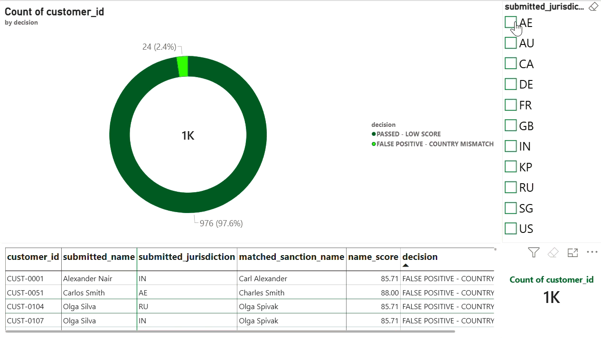

# 🛡️ WISE KYC Compliance & Sanctions Screening Data Pipeline

An end-to-end automated AML (Anti-Money Laundering) and KYC (Know Your Customer) compliance screening pipeline built using **Python, SQLite, and Power BI**. This project simulates real-world regulatory screening workflows—ingesting global watchlist data, executing fuzzy name-matching algorithms, applying false-positive mitigation logic, and visualizing risk analytics via an interactive executive dashboard.

---

## 📊 Dashboard Demo & Overview

> *Interactive Power BI Dashboard displaying compliance audit results, risk distribution, and jurisdiction screening metrics.*

---

## 🚀 Key Features & Architecture

1. **Automated ETL Pipeline (`generate_powerbi_data.py`)**: Processes and structures compliance audit records dynamically, scaling up to 1,000+ realistic screening entries.
2. **Fuzzy Matching Engine (`rapidfuzz`)**: Implements token-sort ratio algorithms to match customer records against global watchlists despite minor spelling variations or alias discrepancies.
3. **Smart False-Positive Mitigation**: Automates decision logic based on composite scoring and jurisdiction mismatch rules:
   * `FLAGGED - CONFIRMED RISK`: High score (>= 85) + Matching jurisdiction.
   * `FALSE POSITIVE - COUNTRY MISMATCH`: High score (>= 85) + Non-matching jurisdiction.
   * `PASSED - LOW SCORE`: Score below threshold.
4. **Executive Power BI Reporting**: Features KPI cards, dynamic filtering, risk breakdown visuals, and country-level compliance auditing metrics.

---

## 🛠️ Tech Stack

- **Data Processing & ETL:** Python (`pandas`, `sqlite3`, `rapidfuzz`, `random`)
- **Database:** SQLite
- **Visualization & BI:** Power BI Desktop (DAX, Data Modeling, Custom UI)
- **Version Control:** Git & GitHub

---

## 📂 Repository Structure

WISE-compliance-data-pipeline/
│
├── generate_powerbi_data.py          # Core pipeline & 1,000-record mock generator
├── kyc_screening_audit.csv           # Cleaned and audited dataset for Power BI
├── Wise_KYC_Compliance_Dashboard.pbix # Power BI report file
├── WISE-Compliance-Dashboard-Demo.gif # Animated UI walkthrough
├── .gitignore                        # Git ignore file
└── [Modular Pipeline Scripts]        # Step-by-step ETL scripts (01 to 06)

---

## ⚙️ How to Run the Pipeline Locally

1. **Clone the Repository:**
   git clone https://github.com/johnthananajit007-afk/WISE-compliance-data-pipeline.git
   cd WISE-compliance-data-pipeline

2. **Install Required Python Libraries:**
   pip install pandas rapidfuzz

3. **Run the Automation Script:**
   python generate_powerbi_data.py

4. **View in Power BI:**
   * Open `Wise_KYC_Compliance_Dashboard.pbix` in Power BI Desktop.
   * Click **Refresh** on the Home tab to load the latest generated records.
